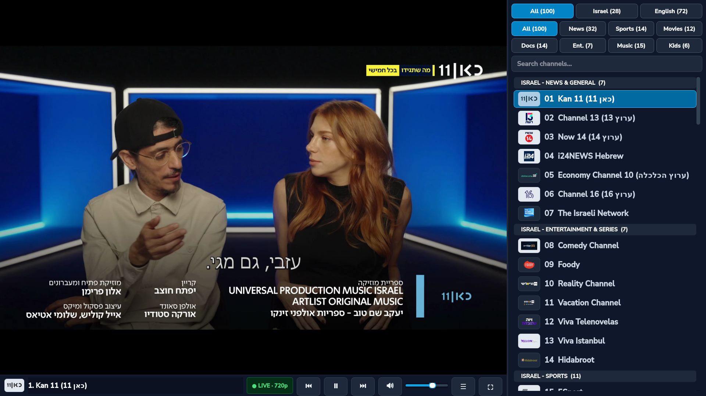

# Pi IPTV

Lightweight, dark-themed **PyQt5 + `mpv`** IPTV player built for Raspberry Pi OS (`labwc` / Wayland + XWayland) with a verified free public playlist (Israel/Hebrew & English).



## Features
- **Hardware-Accelerated `mpv` Playback:** Uses Raspberry Pi 4 H.264/HEVC hardware decoding (`v4l2m2m-copy,drm-copy`) with `--profile=fast` GPU scaling.
- **Automatic 720p Cap (`max720p.lua`):** Single-pass `on_preloaded` Lua hook selects the sharpest HLS variant `<= 720p` and syncs its matching audio track before decoder initialization.
- **Native TV Station Logos:** Downloads and caches `tvg-logo` station icons into pre-rendered auto-contrast `60×40` badges (`logos/badges/`) for fast startup (~110 ms UI init).
- **Organized & Filterable Channel List:** Language filter pills (`All`, `Israel`, `English`), live-counted category pills (`News`, `Sports`, `Movies`, `Docs`, `Ent.`, `Music`, `Kids`), instant search, and bold visual category headers.
- **TV Remote & Keyboard Ready:** Channel list receives immediate focus on startup so `↑`/`↓` + `Enter` and `←`/`→` category cycling work right away.

## Requirements
```bash
sudo apt-get install -y python3-pyqt5 mpv
```

## Quick Start
```bash
~/pi-iptv/launch-iptv.sh
```

## Controls
- **`↑` / `↓`** — Move between channels (skips category headers automatically)
- **`Enter`** or **Single-click** — Play channel
- **`←` / `→`** — Cycle category filters
- **`N` / `P`** or **`PageDown` / `PageUp`** — Next / Previous channel
- **`F`** or **Double-click video** — Toggle Fullscreen (`F` or `Esc` to exit)
- **`Space`** — Play / Pause · **`M`** — Mute · **`+` / `-`** or scroll wheel — Volume
- **`L`** — Toggle channel sidebar · **`/`** or **`Ctrl+F`** — Search · **`Q`** — Quit

## Playlist Maintenance
Verify or prune offline streams anytime:
```bash
python3 ~/pi-iptv/verify-playlist.py          # check all channels
python3 ~/pi-iptv/verify-playlist.py --prune  # remove offline channels (creates .bak)
```
